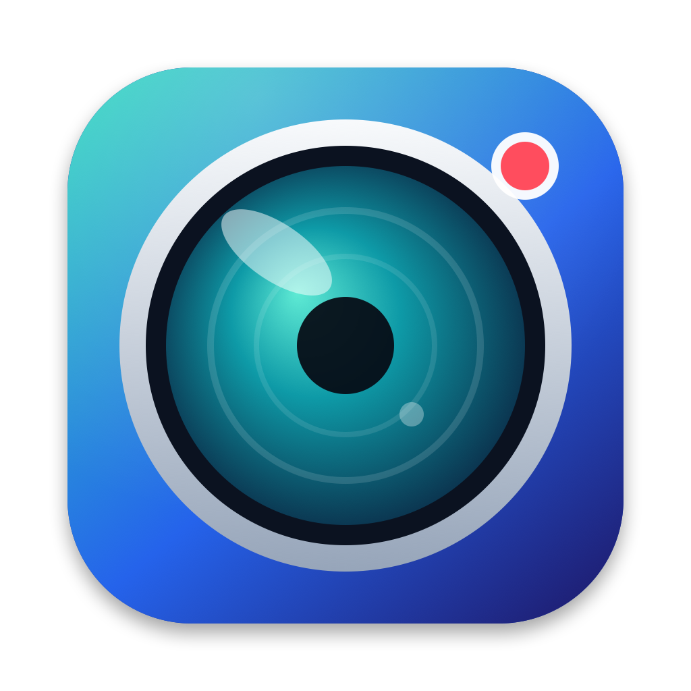
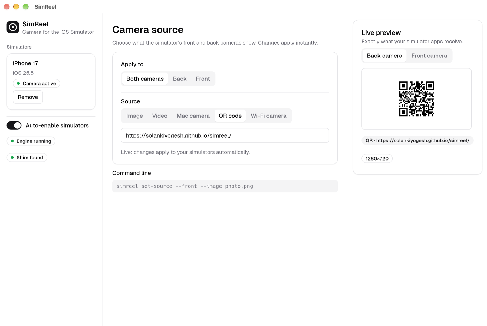
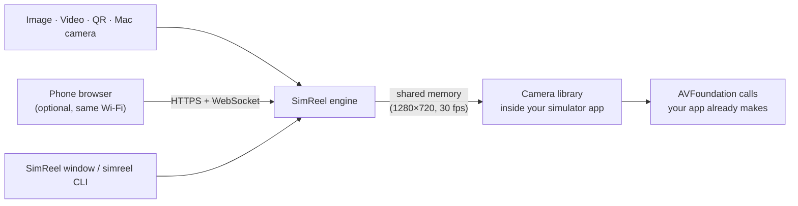

<div align="center">



# SimReel

**A working camera for the iOS Simulator.**

Feed any image, video, QR code or your Mac's webcam to the front and back cameras of your simulators —
with no changes to your app.

[](https://github.com/SolankiYogesh/simreel/releases/latest)
[](https://github.com/SolankiYogesh/simreel/releases)


[Website](https://solankiyogesh.github.io/simreel/) ·
[Download](https://github.com/SolankiYogesh/simreel/releases/latest) ·
[Quick start](#quick-start) ·
[Command line](#command-line) ·
[Platform support](#platform-support) ·
[Feedback](#feedback)

</div>

<p align="center">
  <picture>
    <source media="(prefers-color-scheme: dark)" srcset="docs/screenshot-dark.png">
    
  </picture>
</p>

## Why SimReel

The iOS Simulator has no camera. Anything that opens a capture session — barcode scanners, KYC and
document capture, avatar and profile photos, video calls, AR onboarding — shows a blank screen or an
error, so you end up testing on a physical device for every camera change.

SimReel puts a camera back in the Simulator. You choose what the camera "sees", and your app receives
it through the normal AVFoundation APIs, exactly as it would on a device.

## Features

- **Front and back cameras, independently.** Show a QR code on one and a video on the other.
- **Five sources.** Image (PNG, JPEG), video (MP4, MOV, M4V — looped, honours rotation metadata),
  QR code (any text or URL), your Mac's camera (built-in, external or Continuity Camera) and
  [your phone's camera](#use-your-phone-as-a-camera) streamed over Wi-Fi.
- **Works with the libraries you use.** Apps and libraries that capture through AVFoundation see a working
  camera, including the popular React Native, Swift and Flutter camera libraries — see
  [Compatibility](#compatibility).
- **Light and dark.** A clean interface that follows your Mac's appearance.
- **Portrait and landscape.** Portrait photos, videos and phone streams stay portrait instead of being cropped.
- **Fill or fit.** Crop to fill the frame, or letterbox with 0–30 % padding and a background colour.
- **Live preview and instant apply.** Changes reach your simulators as you make them — no Apply button.
- **Zero setup per simulator.** While SimReel is running it enables itself on every booted simulator,
  including ones you boot later, and puts everything back when you quit.
- **Works with unmodified apps.** Preview layers, frame callbacks, photo capture and barcode scanning
  all behave like a real camera. See [supported camera APIs](#supported-camera-apis).
- **Lives in the menu bar.** While SimReel runs, a menu bar icon shows whether it's active, with a menu for
  status, the Wi-Fi camera switch and Quit. Closing the window keeps SimReel running there.
- **Scriptable.** A `simreel` command-line tool drives the running app, for local scripts and UI-test setup.
- **Private by design.** Everything runs on your Mac. SimReel makes no outgoing network connections and
  collects no data. The optional phone-camera listener is off until you turn it on.
- **Small and fast.** A native Rust app — no Electron, no background daemons.

## Platform support

| | Supported | Notes |
|---|---|---|
| **Host Mac** | macOS 14 (Sonoma) or later, **Apple Silicon** (M1 and newer) | Intel Macs are not supported yet |
| **Required tools** | Xcode with the iOS Simulator | SimReel uses `xcrun simctl` to manage simulators |
| **Simulators** | iOS Simulator on Apple Silicon (iPhone and iPad runtimes) | arm64 simulators only |
| **Apps** | Native iOS apps (Swift, Objective-C) using AVFoundation capture APIs | |
| **Cross-platform frameworks** | React Native, Expo, Flutter, Capacitor and others that wrap AVFoundation | See [Compatibility](#compatibility) |
| **Phone camera source** | A phone with a current browser on the same Wi-Fi — Safari on iPhone, Chrome on Android | Verified with a simulated phone (Chrome with a fake camera); real phones are expected to work but not yet verified — reports welcome |
| **Not applicable** | Windows, Linux, Android Emulator, physical iOS devices | The iOS Simulator only exists on macOS; real devices already have cameras |

**Tested with:** macOS 27, Xcode 27.1, iOS 26.5 simulator on Apple Silicon. Other versions are likely to
work but have not been verified.

### Supported camera APIs

| API | Status |
|---|---|
| `AVCaptureDevice` discovery (`default(for:)`, `DiscoverySession`, `devices(for:)`) | ✅ Front and back wide-angle cameras |
| `AVCaptureSession` with `AVCaptureDeviceInput` | ✅ |
| `AVCaptureVideoPreviewLayer` | ✅ Honours `videoGravity` |
| `AVCaptureVideoDataOutput` | ✅ BGRA and 420v/420f (NV12) pixel formats, 1280×720 (or 720×1280) at up to 30 fps |
| `AVCaptureMetadataOutput` | ✅ QR codes verified; other barcode types are best-effort |
| `AVCapturePhotoOutput` | ✅ JPEG capture at the frame size |
| Flash, torch, zoom, focus and exposure controls | ⚪ Accepted and ignored |
| `AVCaptureMovieFileOutput` (video recording) | ❌ Not yet |
| Depth data, Live Photos, multi-camera sessions, ARKit | ❌ Not supported |
| `UIImagePickerController` camera UI | ❓ Untested |

## Compatibility

SimReel works at the **AVFoundation capture layer**, which is what camera code on iOS is built on. Any app or
library that opens the camera through the [supported capture APIs](#supported-camera-apis) sees a working front
and back camera in the Simulator, with no code changes. That covers the popular camera libraries listed below,
because they sit on top of those APIs.

> **Status.** SimReel is verified with a native AVFoundation sample app (preview layer, video frames, QR
> scanning and photo capture). The third-party libraries below have **not been individually tested yet**: the
> tables show what each one builds on, so you know what to expect. Test results are very welcome — please
> [open an issue](https://github.com/SolankiYogesh/simreel/issues).

**What to watch for in any library**

- Video recording through `AVCaptureMovieFileOutput` isn't supported yet.
- Libraries that read device formats (`AVCaptureDevice.formats` or `activeFormat`) to choose a resolution or
  frame rate — common in WebRTC and high-performance camera libraries — currently get an empty list.
- Some libraries deliberately skip the camera in the Simulator (`#if targetEnvironment(simulator)`) and show a
  placeholder instead. SimReel can't change that.
- System camera screens (`UIImagePickerController`), ARKit and VisionKit's `DataScannerViewController` aren't
  covered.

### React Native and Expo

| Library | Builds on |
|---|---|
| `react-native-vision-camera` and its frame-processor plugins | `AVCaptureSession`, video data output, metadata output (code scanner), photo output. Reads device formats. |
| `expo-camera` (`CameraView`) | `AVCaptureSession`, preview layer, metadata output (barcodes), photo output. Video recording uses a movie output. |
| `react-native-camera-kit` | `AVCaptureSession`, metadata output, photo output |
| `react-native-camera` (deprecated) and `react-native-qrcode-scanner` | `AVCaptureSession`, metadata output, photo and movie output |
| `react-native-webrtc` | `AVCaptureSession` through WebRTC's camera capturer. Reads device formats. |
| `expo-image-picker`, `react-native-image-picker` (camera mode) | `UIImagePickerController`: not covered |

### Swift and Objective-C

| Library | Builds on |
|---|---|
| AVFoundation (Apple) | **Verified**: preview layer, video data output, metadata output, photo output |
| Vision (barcode, face and text requests on camera frames) | Video data output |
| Google ML Kit (barcode, face, text) on camera frames | Video data output |
| `BarcodeScanner` (hyperoslo) | `AVCaptureMetadataOutput` |
| `CodeScanner` (twostraws) | `AVCaptureMetadataOutput`; shows its own simulated UI in the Simulator by design |
| `SwiftyCam`, `CameraManager`, `YPImagePicker` | `AVCaptureSession`, photo output; video recording uses a movie output |
| `GPUImage` 2 / 3 | Camera input from the video data output |
| WebRTC SDKs: Twilio Video, Agora, Stream Video, LiveKit, Daily, Jitsi | `AVCaptureSession` through the WebRTC camera capturer. Read device formats. |
| `HaishinKit` | `AVCaptureSession`; reads device formats |
| `UIImagePickerController`, VisionKit `DataScannerViewController`, ARKit | Not covered |

### Flutter

| Package | Builds on |
|---|---|
| `camera` (`camera_avfoundation`) | `AVCaptureSession`, video data output, photo output. Reads device formats for resolution presets. |
| `mobile_scanner` | `AVCaptureSession` frames decoded with Vision or ML Kit |
| `camerawesome` | `AVCaptureSession`, photo and video |
| `qr_code_scanner`, `qr_code_scanner_plus`, `barcode_scan2` | `AVCaptureSession` with `AVCaptureMetadataOutput` |
| `google_mlkit_*` on frames from `camera` | Video data output |
| `flutter_webrtc`, `agora_rtc_engine`, `livekit_client`, Twilio | `AVCaptureSession` through the WebRTC camera capturer. Read device formats. |
| `image_picker` (camera source) | `UIImagePickerController`: not covered |

## Quick start

1. **Install** with [Homebrew](https://brew.sh):

   ```sh
   brew install --cask SolankiYogesh/tap/simreel
   ```

   or download the latest `.dmg` from the [Releases page](https://github.com/SolankiYogesh/simreel/releases/latest),
   open it and drag **SimReel** to **Applications**.
2. **Open SimReel.** Your booted simulators appear on the left and are enabled automatically.
3. **Run your app** in a simulator and open its camera screen. Pick a source in SimReel — the app sees it
   immediately.

> **Relaunch apps that were already running.** A simulator app picks up the camera when it launches, so
> restart any app that was open before SimReel enabled the simulator.

### First launch and macOS Gatekeeper

Release builds are signed ad hoc, not with an Apple Developer ID. The Homebrew install clears the quarantine flag
for you. If you installed from the `.dmg` and macOS says SimReel "cannot be verified", right-click the app in Applications, choose **Open**, then confirm. Or remove the quarantine flag:

```sh
xattr -dr com.apple.quarantine /Applications/SimReel.app
```

Verify a download with the `SHA256SUMS.txt` file attached to each release:

```sh
shasum -a 256 -c SHA256SUMS.txt
```

### Update and uninstall (Homebrew)

```sh
brew upgrade --cask simreel
brew uninstall --cask simreel
```

## Use your phone as a camera

Stream a real phone camera into the Simulator — useful for testing with real faces, documents and codes.
It needs no app on the phone, only its browser.

1. In SimReel, choose the **Wi-Fi camera** source and press **Turn on phone cameras**.
2. Scan the QR code with your phone's camera app. The phone and the Mac must be on the same Wi-Fi.
3. The first time, the phone warns about the connection, because the Mac uses its own certificate. Tap
   **Show Details → visit this website** (on Android: **Advanced → Proceed**).
4. On the page, tap **Start camera** and allow camera access. The phone appears in the **Phones** list —
   select it and the Simulator apps see its camera.

Pick the back or front camera and the quality on the phone page. Keep the page open and the screen on
while streaming.

**How it stays safe:**

- The listener is **off by default** and stops when you turn it off or quit SimReel.
- Every link contains a random token that changes each time you turn it on; requests without it get a 404.
- The link uses HTTPS with a certificate generated on your Mac (in
  `~/Library/Application Support/SimReel`). Browsers require HTTPS for camera access.
- Frames go only to your Mac. Nothing is sent to the internet.
- macOS may ask whether SimReel can accept incoming network connections. Choose **Allow**.

Networks that isolate devices from each other (guest Wi-Fi, some office and hotel networks) block this.

## Using the app

| Area | What it does |
|---|---|
| **Simulators** (sidebar) | Lists booted simulators with a status badge: *Camera active*, *Not enabled*, or *Another tool is active*. **Remove** turns SimReel off for one simulator and keeps it off. |
| **Auto-enable simulators** (sidebar) | When on (the default), new simulators are enabled as soon as they boot. |
| **Apply to** | Choose both cameras, or just the back or front camera. |
| **Source** | Pick an image, video, Mac camera, QR code or a Wi-Fi camera (a phone). |
| **Scaling** | *Fill* crops to cover the frame; *Fit* letterboxes with optional padding and background colour. |
| **Live preview** | Shows exactly what the simulator apps receive, with the source and frame size. |

Changes apply to your simulators as you make them. The window follows your Mac's light or dark appearance.

### Menu bar

SimReel adds an icon to the menu bar while it runs. A solid lens means at least one simulator has the camera
active; a thin ring means it's idle. Click it for the current state, each camera's source, **Show SimReel**,
**Turn on/off Wi-Fi camera** and **Quit SimReel**.

Closing the window with the red button hides it and leaves SimReel running, so simulators keep their camera.
Bring the window back from the Dock icon or **Show SimReel**. Quit from the menu bar item or with ⌘Q.

The **Mac camera** source asks for camera permission the first time you use it. If you deny it, allow
SimReel in **System Settings → Privacy & Security → Camera**.

## Command line

The `simreel` tool ships inside the app and controls the running SimReel app. Add it to your `PATH`:

```sh
ln -s /Applications/SimReel.app/Contents/Helpers/simreel /usr/local/bin/simreel
```

```sh
simreel status                                   # current sources, as JSON
simreel cameras                                  # Mac cameras you can use as a source

simreel set-source --image ~/Pictures/id-card.png
simreel set-source --front --video ~/Movies/walkthrough.mp4
simreel set-source --back --qr "https://example.com/ticket/42"
simreel set-source --camera "FaceTime HD Camera"

# Use a phone's camera (see "Use your phone as a camera")
simreel phone on                                 # starts the listener and prints the link phones open
simreel devices                                  # phones that have connected
simreel set-source --remote "iPhone"             # by name or id
simreel phone off

# Scaling for images and videos
simreel set-source --image photo.png --fit --fit-padding 10 --background-color "#FFFFFF"

# Manual control of simulators (the app does this for you by default)
simreel inject --device booted
simreel eject  --device booted
```

| Command | Description |
|---|---|
| `status` | Prints the active front/back sources as JSON. |
| `cameras` | Lists the Mac cameras that can be used with `--camera`. |
| `phone on\|off` | Turns the phone-camera listener on or off and prints the link phones open. |
| `devices` | Lists the phones that have connected, with resolution and frame rate. |
| `set-source [--front\|--back] (--image P \| --video P \| --camera [NAME] \| --qr TEXT \| --remote PHONE)` | Sets the source. Without `--front`/`--back` it applies to both cameras. |
| `--fill` / `--fit`, `--fit-padding N`, `--background-color #RRGGBB` | Scaling for `--image` and `--video`. Padding is one of 0, 5, 10, 20, 30. |
| `inject [--device UDID\|booted]` / `eject` | Enable or disable SimReel in a simulator. |

All commands print JSON and exit with a non-zero status on failure. The SimReel app must be running.

## How it works



1. **The engine** (in the SimReel app) turns the chosen source into frames (1280×720, or 720×1280 for
   portrait sources) — one slot for the back camera, one for the front — and publishes them to a
   shared-memory file.
2. **A small camera library**, loaded into each simulator app at launch, presents a front and a back
   camera and answers the AVFoundation capture APIs with those frames.
3. **SimReel enables the library per simulator** through the simulator's launch environment, so apps need
   no code changes, no SDK and no build settings.

Frames travel through a local file in `/private/tmp/simreel`. When you use a phone source, its frames
arrive over your local network, and nothing is sent to the internet.

## Troubleshooting

| Symptom | What to try |
|---|---|
| The app still sees no camera | Make sure the simulator shows **Camera active** in SimReel, then **relaunch the app** you are testing. |
| Frames are grey | The SimReel app is not running or has quit. Open it again. |
| "Another camera tool is active" | Another tool already loads its own library into that simulator. Choose **Use SimReel** to switch; **Remove** restores the previous setting. Run only one such tool per simulator. |
| "SimReel is already running" | Only one engine can run at a time. Quit the other instance first. |
| The phone can't open the link | Check both are on the same Wi-Fi (not a guest or isolated network), that phone cameras are **on** in SimReel, and that you allowed incoming connections when macOS asked. Turning it off and on creates a new link. |
| The phone says it can't use the camera | Open the link in Safari (iPhone) or Chrome (Android), accept the certificate warning, and allow camera access. The camera needs HTTPS and a browser tab left open. |
| Mac camera does nothing | Allow camera access in **System Settings → Privacy & Security → Camera**. |
| `simreel` says it cannot reach SimReel | Open the SimReel app first; the command-line tool talks to the running app. |
| The simulator asks for camera access | Allow it, exactly as on a device. To pre-approve an app: `xcrun simctl privacy booted grant camera <bundle-id>`. |
| The window disappeared | It's hidden, not closed. Click SimReel in the Dock, or choose **Show SimReel** from the menu bar icon. |
| Simulator rebooted | Keep SimReel running; it enables the simulator again within a few seconds. |

Set `SIMREEL_DEBUG=1` in an app's launch environment to log barcode-detection details to its console.

## Limitations

- Apple Silicon Macs only; Intel Macs are not supported yet.
- Frames are 1280×720 (or 720×1280 for portrait sources) at up to 30 fps. Sources are scaled into that frame,
  so very small ones look soft.
- Phone streams are JPEG over Wi-Fi: expect a short delay and a frame rate that depends on your network.
- Landscape sources shown in a portrait app are aspect-filled, so the sides are cropped.
- Video recording (`AVCaptureMovieFileOutput`), depth data, Live Photos and ARKit are not supported.
- If SimReel crashes, simulators stay enabled and apps receive grey frames until it is relaunched.

## Feedback

SimReel's source code is not published, but this repository is the place for everything else:

- **Something broke?** [Report a bug](https://github.com/SolankiYogesh/simreel/issues/new?template=bug_report.yml).
- **Want something added?** [Request a feature](https://github.com/SolankiYogesh/simreel/issues/new?template=feature_request.yml).
- **Tried it with a camera library or framework?** [Share a compatibility report](https://github.com/SolankiYogesh/simreel/issues/new?template=compatibility_report.yml) — what works and what doesn't is the most valuable feedback.
- **Anything else?** [Start a feedback thread](https://github.com/SolankiYogesh/simreel/issues/new?template=feedback.yml).

Please search the [existing issues](https://github.com/SolankiYogesh/simreel/issues) first, and include your macOS and Xcode versions.

## License

SimReel is free to use. The bundled [Geist](https://github.com/vercel/geist-font) typeface is licensed under the
SIL Open Font License 1.1.
